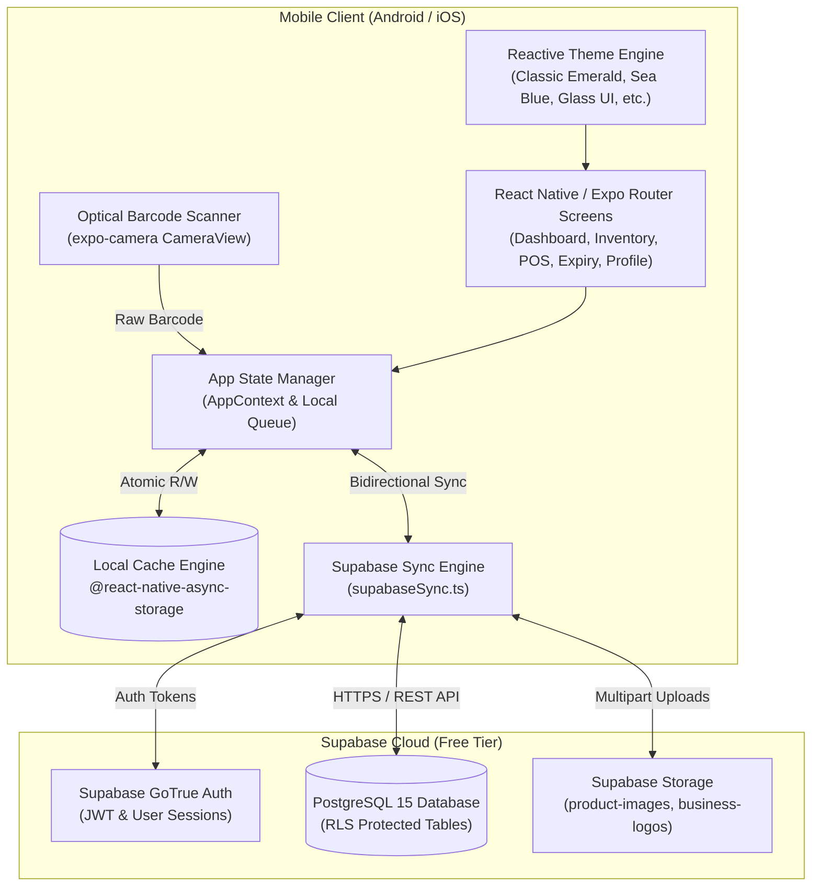
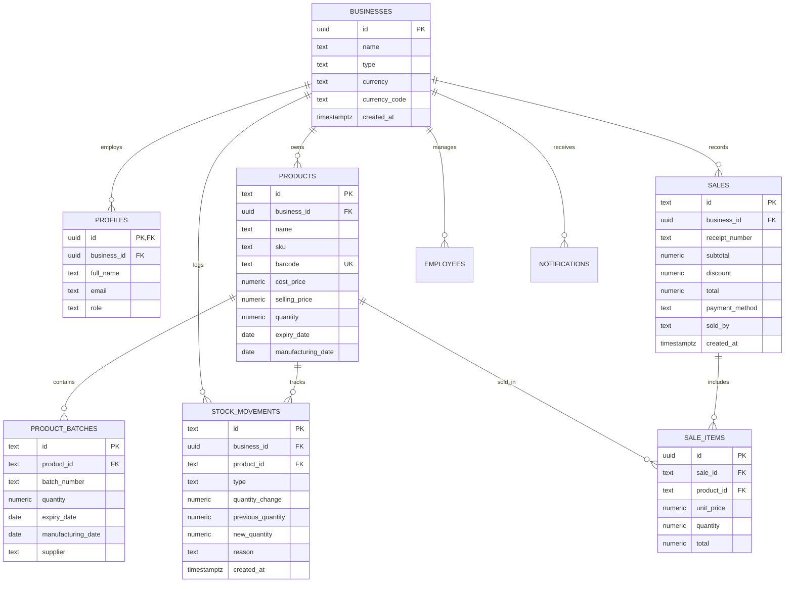

# Stockwise 📦

> **Offline-First Retail Inventory Management, Optical Barcode Scanner, Expiry Detection Engine & Point of Sale (POS)**  
> *Built with Expo SDK 58, React Native 0.88, TypeScript, Supabase (PostgreSQL), and Local-First Architecture.*

[](LICENSE)
[](https://expo.dev)
[](https://reactnative.dev)
[](https://www.typescriptlang.org)
[](https://supabase.com)
[](https://github.com/Elijahamet/Stockwise/releases)

---

## 📌 Executive Summary

**Stockwise** is a production-engineered mobile inventory management and retail POS terminal built specifically for retail shops, supermarkets, and pharmacies operating in environments with intermittent, slow, or zero internet connectivity.

Unlike traditional cloud-dependent inventory software that freezes or stalls during network dropouts, Stockwise implements an **offline-first local architecture**: every barcode scan, sales transaction, batch shelf-life audit, and inventory adjustment executes instantaneously against an on-device local storage engine. When an internet connection is available, Stockwise synchronizes seamlessly with a **Supabase PostgreSQL** cloud backend.

---

## 🚨 Problem Stockwise Solves

Retailers and supermarket operators in emerging economies encounter critical everyday operational hurdles:
1. **Network Outages & Brownouts:** Cloud-only POS terminals fail during cellular outages or power cuts, leaving cashiers unable to checkout customers.
2. **Product Expiration Waste:** Over 15% of perishable inventory shrinkage occurs because stock batches expire undetected on shelves.
3. **Slow Barcode Queries:** Round-tripping camera barcode scans to remote APIs introduces perceptible 2–4 second delays per item at checkout.
4. **Cloud Cost Barriers:** Small business owners cannot afford recurring monthly enterprise software subscriptions or per-seat fees.

Stockwise eliminates these pain points through:
- **Instant Optical Scans:** Local inventory barcode lookups in < 50ms with camera reticle integration.
- **Automated Expiry Warning Engine:** Color-coded 30-day thresholds preventing sales of expired goods.
- **100% Offline Capability:** All business logic, checkout calculations, and reporting operate offline without remote servers.
- **Zero-Cost Deployment:** Engineered to run within the free tiers of Supabase, Expo EAS, and GitHub Releases.

---

## 🏗️ System Architecture



---

## 🗄️ Database Design & Schema

The database design adheres to 3NF relational normalization while supporting multi-batch inventory, lot-specific expiration dates, and immutable stock movement audit trails.



---

## 🌟 Core Features

### 1. Barcode Scanner & Real-Time Expiry Detection
- **Optical Camera Engine:** Real-time barcode reading powered by `expo-camera` (`CameraView`) with laser targeting guide and torch toggle.
- **Local In-Memory Index:** Zero network roundtrip — matches barcodes directly against local inventory in milliseconds.
- **Categorized Expiry Statuses:**
  - 🟢 **NOT EXPIRED:** Shelf life > 30 days remaining.
  - 🟡 **EXPIRING SOON:** Within configurable 30-day window (displays amber warning).
  - 🔴 **EXPIRED:** Shelf life passed — blocks sales and triggers prominent alert:  
    `WARNING: THIS PRODUCT HAS EXPIRED. DO NOT SELL IT.`
  - ⚪ **EXPIRY DATE UNKNOWN:** Unrecorded expiry date (safely handled, never erroneously flagged as expired).
- **Instant Scan Actions:** View product profile, update expiration dates, record expired stock write-offs, or add unrecognized barcodes.

### 2. Multi-Batch Inventory Architecture
- Support for products with multiple stock deliveries expiring on different dates.
- Each shipment is assigned an isolated batch record (`ProductBatch`) tracking batch number, arrival date, received quantity, and supplier details.
- Earliest-expiring batch automatically bubbles up as the primary expiry date for customer protection.

### 3. POS Terminal & Stock Guardrails
- **Cart Calculations:** Subtotals, customizable discount overrides, and total tax computations.
- **Safety Expiry Barrier:** Automatically flags and warns cashier before completing checkout if an item in the cart is expired.
- **Negative Stock Prevention:** Prohibits selling beyond available on-hand quantities.
- **Payment Split:** Cash, Mobile Money (MoMo), Card, and Bank Transfer with receipt generation.

### 4. Interactive Display Theme Engine
Supports 7 reactive themes with system-wide color propagation across tabs, headers, buttons, graphs, and input focus rings:
1. **Classic Emerald:** Signature Stockwise Brand Green (`#0A241D`, `#16986C`, `#2CE5A7`) - *Default*.
2. **Sea Blue:** Deep Oceanic Sapphire & Sky Cyan.
3. **Sunset Orange:** Terracotta & Tangerine.
4. **Royal Purple:** Velvet Amethyst & Violet.
5. **iOS 27 Liquid Glass:** Frosted glassmorphism with neon acrylic glow.
6. **Sunburst Yellow:** Luminous Golden Amber & Honey.
7. **Crimson Red:** High-contrast Scarlet Ruby & Mahogany.

---

## 🛠️ Technology Stack

| Layer | Technology | Purpose |
|---|---|---|
| **Framework** | Expo SDK 58 | Native compilation, CNG (Continuous Native Generation) |
| **Runtime** | React Native 0.88.1 / React 19 | Cross-platform UI runtime |
| **Language** | TypeScript 5.8+ | Strict type safety, interface contracts |
| **Routing** | Expo Router (v58) | File-based typed screen navigation |
| **Camera & Hardware**| `expo-camera` | Hardware barcode scanning & flashlight control |
| **Local Persistence**| `@react-native-async-storage` | Durable offline key-value storage |
| **Backend & Database**| Supabase (PostgreSQL 15) | Relational cloud storage with Row Level Security |
| **Vector Graphics** | `react-native-svg` | Smooth SVG Bezier analytics line charts |
| **Build & Release** | Expo EAS Build & GitHub Releases | Cloud-compiled installable Android APK |

---

## ⚙️ Environment Variables & Configuration

Stockwise utilizes public Expo environment variables. Create a `.env` file in the project root:

```bash
cp .env.example .env
```

Edit `.env` with your Supabase credentials:

```ini
# Supabase Project URL (Project Settings -> API -> Project URL)
EXPO_PUBLIC_SUPABASE_URL=https://your-project-id.supabase.co

# Supabase Anon Public Key (Project Settings -> API -> Project API keys -> anon)
EXPO_PUBLIC_SUPABASE_ANON_KEY=eyJhbGciOiJIUzI1NiIsInR5cCI6IkpXVCJ9...
```

> **Security Note:** Never commit `.env` or paste your `service_role` secret key into client-side code. The public `anon` key is strictly protected by PostgreSQL Row Level Security (RLS) policies.

---

## 🚀 Local Development Setup

### Prerequisites
- Node.js (v18.x or v20.x recommended)
- Git
- Expo Go application on your mobile device (iOS App Store or Google Play)

### Installation Steps

1. **Clone the repository:**
   ```bash
   git clone https://github.com/Elijahamet/Stockwise.git
   cd Stockwise
   ```

2. **Install dependencies:**
   ```bash
   npx expo install
   ```

3. **Start the local Metro Bundler:**
   ```bash
   npx expo start
   ```

4. **Connect via Expo Go:**
   - Scan the terminal QR code with your mobile Camera app.
   - For remote testing across separate Wi-Fi networks:
     ```bash
     npx expo start --tunnel
     ```

5. **Typecheck & Quality Checks:**
   ```bash
   npx tsc --noEmit
   npx expo-doctor
   ```

---

## 📱 Android APK Build & Installation (Free via EAS)

You can build a standalone installable Android APK without paying for a Google Play Console developer account using **EAS Build** (Expo Application Services).

### 1. Configure EAS Build
Ensure `eas.json` is configured for an APK preview build:
```json
{
  "build": {
    "preview": {
      "distribution": "internal",
      "android": {
        "buildType": "apk"
      }
    }
  }
}
```

### 2. Generate the APK
Run the cloud build command:
```bash
npx eas-cli build --platform android --profile preview
```
1. When prompted to log in, authenticate with your free Expo account.
2. EAS will build the native Android binary in the cloud.
3. Upon completion, EAS provides a direct download URL for the `.apk` file.

### 3. Install on Physical Android Device
1. Download the generated `.apk` file onto your Android smartphone.
2. Tap the downloaded file in your browser or Downloads folder.
3. If prompted by Android security, select **Settings** &rarr; toggle on **"Allow from this source"** (Install Unknown Apps).
4. Tap **Install** and launch Stockwise.

---

## 🧠 Engineering Decisions & Technical Challenges

### 1. True Offline-First vs. Cloud Sync
* **Challenge:** How to provide snappy local responsiveness while still supporting multi-device team collaboration?
* **Solution:** We decoupled user interaction from network I/O. All screen operations mutate the local `AsyncStorage` state immediately. Mutations append an action log to an internal sync queue. When connectivity is restored, `supabaseSync.ts` pushes local batches and pulls server updates idempotently.

### 2. Microsecond Optical Barcode Processing
* **Challenge:** Camera frames stream at 30–60 FPS. If every frame triggers state lookups, the JS bridge becomes congested.
* **Solution:** Implemented throttling debounces, dedicated scanner lock flags (`isScanningLockedRef`), and normalized barcode strings (stripping leading zeroes and whitespace) against a local in-memory hash map.

### 3. Shelf-Life Date Boundary Arithmetic
* **Challenge:** Date boundary edge cases (timezone shifts, leap years, products without recorded expiration dates).
* **Solution:** Isolated date computations inside `src/utils/expiry.ts`. Dates are parsed at `00:00:00` UTC device time to prevent timezone day-offset bugs. Products without expiry dates explicitly resolve to `EXPIRY_DATE_UNKNOWN` and are never falsely marked expired.

---

## 💰 Free-Tier Hosting & Cost Analysis

Stockwise is deliberately architected for **zero operational cost** during demonstration and portfolio evaluation:

| Service | Free Tier Allocation | Stockwise Consumption | Cost |
|---|---|---|---|
| **Supabase Database** | 500 MB PostgreSQL storage, 50,000 Monthly Active Users | ~15 MB for catalog & sales | **$0.00** |
| **Supabase Auth** | 50,000 MAU with email & social providers | Store owner & employee accounts | **$0.00** |
| **Expo EAS Build** | 30 free Android builds / month | ~2–4 preview APK builds | **$0.00** |
| **GitHub Releases** | Unlimited public releases (up to 2 GB per asset) | ~50 MB per APK download | **$0.00** |
| **GitHub Repository** | Unlimited public source code & Git LFS | Full source code & documentation | **$0.00** |

*Note on Supabase Free Tier:* Projects on the free tier pause after 1 week of complete inactivity. Any read or write operation immediately resumes the database.

---

## 🔮 Future Roadmap

- [ ] Bluetooth thermal receipt printer integration (ESC/POS protocol).
- [ ] Push notifications for products expiring within 7 days.
- [ ] Automated daily CSV inventory backups to Google Drive.
- [ ] Multi-store warehouse transfers and inter-branch stock requests.

---

## 📄 License

Distributed under the MIT License. See `LICENSE` for more information.

---

**Developed with ❤️ by [Elijah](https://github.com/Elijahamet) — Engineering portfolio demonstration.**
